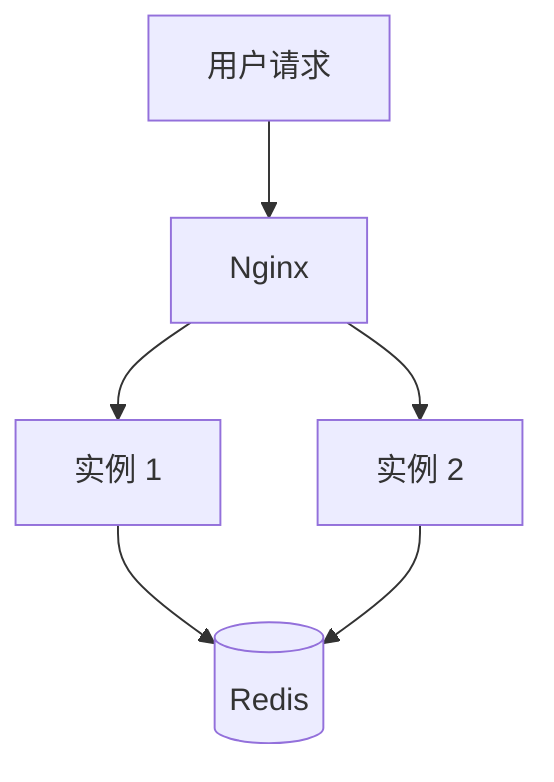
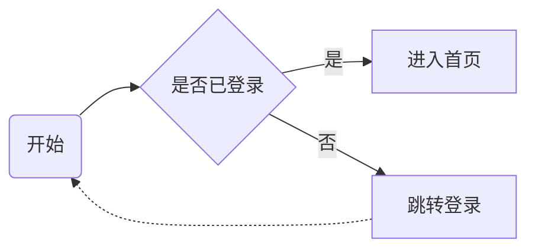
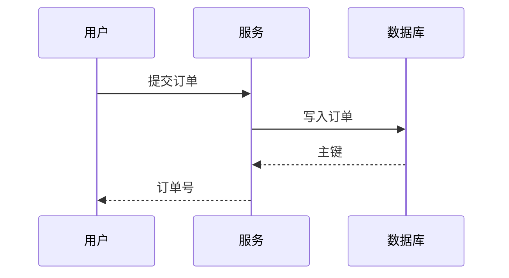
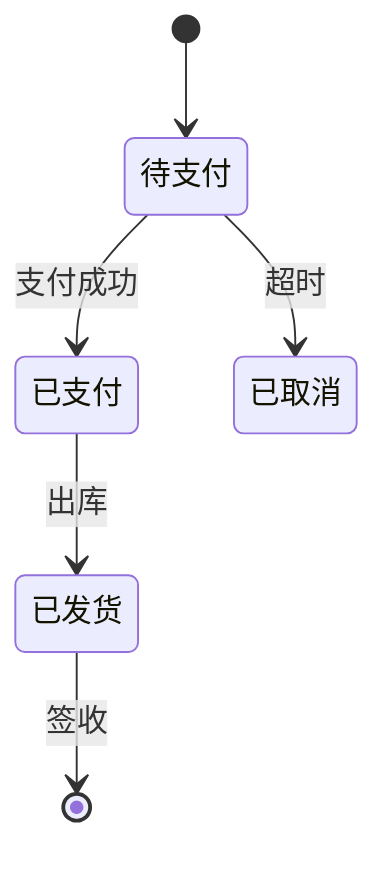
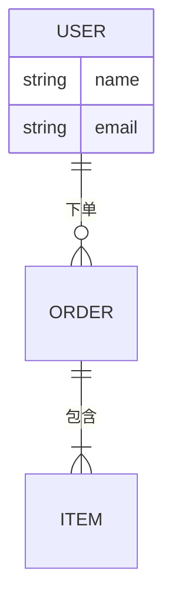
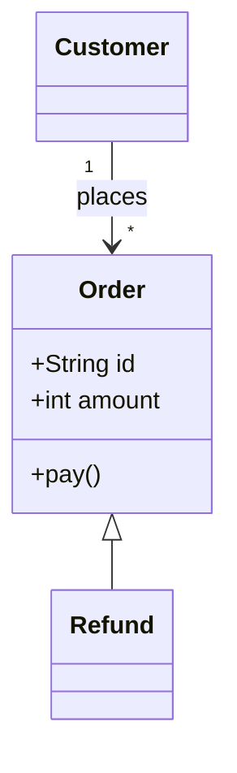
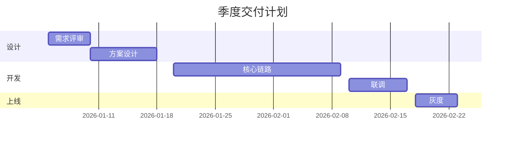
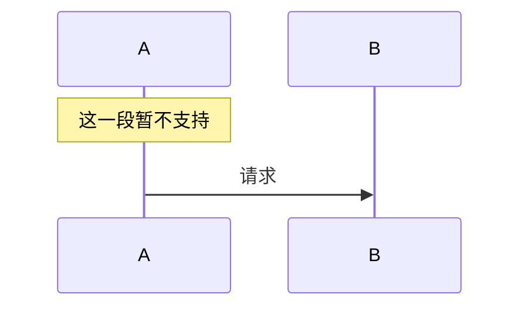

# 图型速查

下面每一节给出一段源码和它的渲染结果。**规则只有一条**：解析失败就原样退回代码块，绝不画出半对半错的图。

## 流程图



横向流程与判断分支：



## 时序图



## 状态机



## ER 图



## 类图



## 用例图

```usecase
actor 用户
actor 运营
usecase 浏览商品
usecase 下单
usecase 上架商品
用户 --> 浏览商品
用户 --> 下单
运营 --> 上架商品
```

## 排期图



## ASCII 架构图（自动识别）

用制表符和箭头画的图会被自动识别；识别不了就按"图"排版显示文本。

```text
用户请求
   ↓
Nginx / 负载均衡器
   ├── 应用实例 1
   ├── 应用实例 2
   └── 应用实例 N
          ↓
 Redis、数据库、共享文件存储
```

## 不支持的写法

下面这段用了 mermaid 的 `Note`，本项目不支持，于是整块原样显示——**这是设计行为，不是缺陷**：


