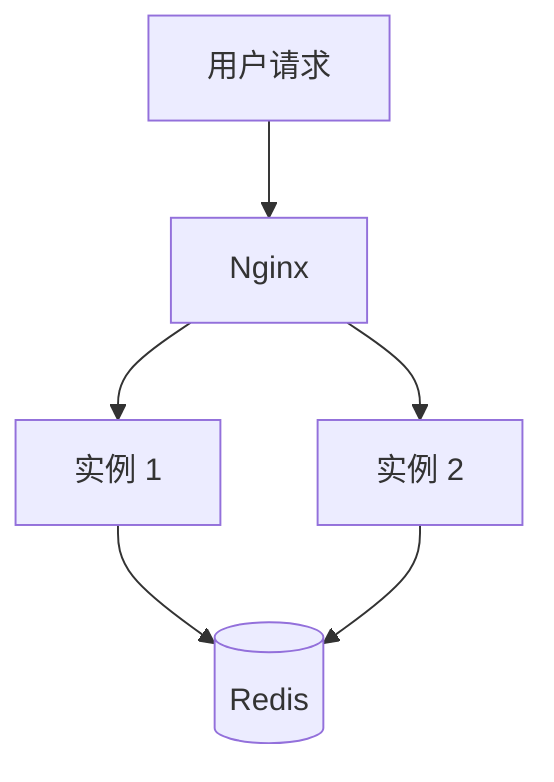
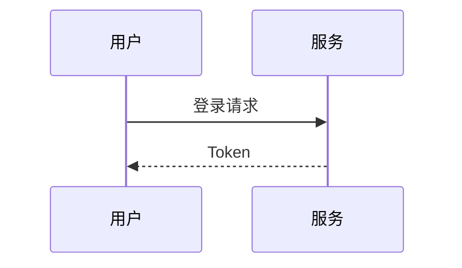
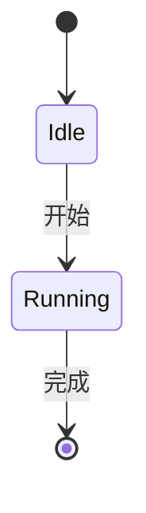
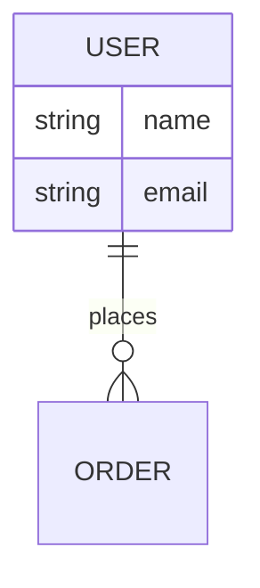
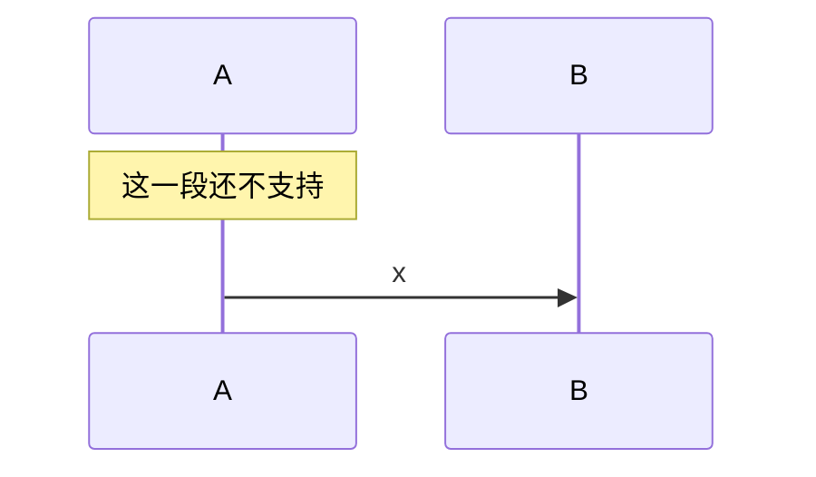
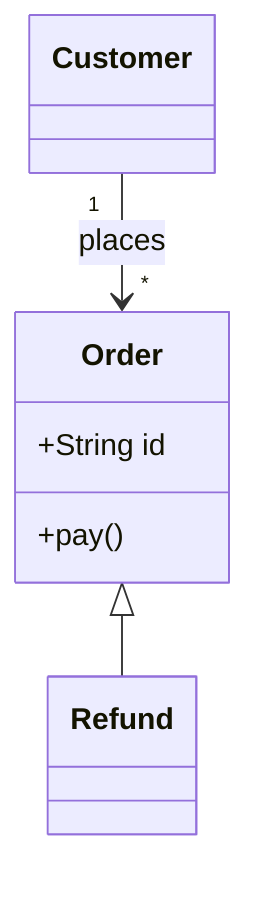
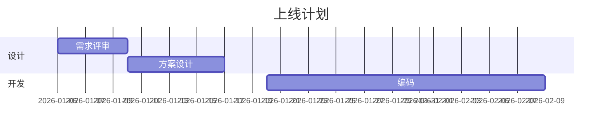
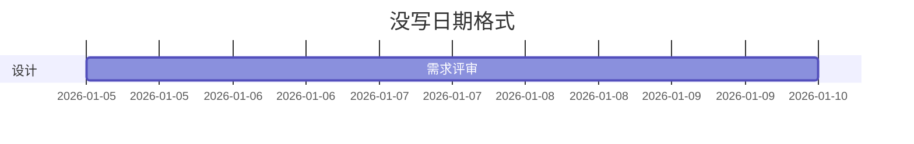

# 功能自检样本

## 提示块：三种语义

> 提示：这一条以「提示」开头，应渲染为 note 形态的提示块。

> 注意：这一条以「注意」开头，应渲染为 warning 形态，图标是感叹号。

> 危险：这一条以「危险」开头，应渲染为 danger 形态，图标是叉。

> 这是一段普通引用，没有任何语义首词，应当保持引用块原貌，不得被改造成提示块。

## 表格：数值列判定

<!-- md: table -->

| 月份 | 请求数 | 失败数 | 备注 |
| --- | --- | --- | --- |
| 1 | 16,180 | 3,150 | 正常 |
| 2 | 12,400 | 210 | 正常 |
| 3 | 9,820 | 5 | 正常 |

## 表格：非数值列

| 主张 | 出处 | 结论 |
| --- | --- | --- |
| HTML 更适合 LLM | Cloudflare | 被反驳 |
| MD 更适合 agent | Mintlify | 被反驳 |

## 代码块

```js
const out = render(md); // 同一输入必得同一输出
```

## 锚点与层级

### 三级标题也要进目录

正文。

### 第二个三级标题

正文。

## 图形化：两列表 → 对比卡片

| 术语 | 说明 |
| --- | --- |
| 真源 | 唯一被编辑、被 diff、被 agent 读写的那份 markdown |
| 阅读面 | 人实际打开来读的那层呈现物，随时可以从真源重建 |
| 制品 | 单文件自包含 HTML，样式与脚本全部内联 |

## 图形化：三列表保持表格（对比矩阵不该被卡片化）

| 方案 | 优点 | 代价 |
| --- | --- | --- |
| MD 为真源 | 可 diff、可被 agent 读 | 人读不下去 |
| HTML 为阅读面 | 可分享、可导航 | 需要渲染器 |

## 图形化：定义卡片

- 真源：唯一被编辑、被 diff、被 agent 读写的那份 markdown
- 阅读面：人实际打开来读的那层呈现物，随时可以从真源重建
- 制品：单文件自包含 HTML，样式脚本全部内联

## 图形化：步骤流

1. 解析 markdown，生成确定性锚点
2. 在构建期静态写入导航与目录
3. 按严格条件做图形化重排
4. 输出单文件 HTML 与同源 `.md`

## 图形化：关闭开关

<!-- md: no-visual -->

- 真源：这一条不应被转成定义卡片
- 阅读面：这一条也不应被转成定义卡片

<!-- md: visual -->

- 恢复：这一条应重新变回定义卡片
- 继续：所以这一段会以卡片形式出现

## 图形化：数值列条形图

| 季度 | 请求数 | 说明 |
| --- | --- | --- |
| Q1 | 16,180 | 基线 |
| Q2 | 12,400 | 回落 |
| Q3 | 9,820 | 低谷 |
| Q4 | 22,600 | 峰值 |

序号列不画条（1,2,3 没有信息量）：

| 序号 | 备注 |
| --- | --- |
| 1 | 第一条 |
| 2 | 第二条 |
| 3 | 第三条 |

## 图形化：ASCII 架构图按图示排版

```text
用户请求
   ↓
Nginx / 负载均衡器
   ├── 单体实例 1
   ├── 单体实例 2
   └── 单体实例 N
          ↓
   Redis、数据库、共享文件
```

普通文本块不应被当成图：

```text
npm install
npm run test
```

## 图形化：四种可识别的图示写法

竖向分层（带分支）：

```text
用户请求
 ↓
Nginx
 ├── 实例 1
 ├── 实例 2
 └── 实例 N
 ↓
Redis
```

树形（头节点 + 分支，无箭头）：

```text
NFS/NAS
  ├── 应用 1：/data
  ├── 应用 2：/data
  └── 应用 N：/data
```

单行链条：

```text
应用 → Mycat 集群 → 主库 / 从库
```

续行链条：

```text
GitLab
→ Jenkins 构建
→ Docker 镜像
→ Harbor
```

识别不了的（框线汇聚）退回文本图示：

```text
应用实例 1 ─┐
应用实例 2 ─┼── Redis Session
应用实例 N ─┘
```

## mermaid：流程图



## mermaid：时序图



## mermaid：状态机



## mermaid：ER 图



## mermaid：不支持的语法要原样退回代码块



## mermaid：类图



## 用例图（本项目扩展语法）

```usecase
actor 用户
actor 管理员
usecase 登录
usecase 下单
用户 --> 登录
用户 --> 下单
管理员 --> 登录
```

## mermaid：排期图



## mermaid：排期图缺 dateFormat 要退回



## 图示：分支带箭头

```text
Master
  ├──→ Replica1
  └──→ Replica2
```

## 图示：映射关系（多行 A → B）

```text
读压力大
→ 增加 Replica

写压力大
→ Redis Cluster

单机放不下
→ 分片 + Cluster
```

## 图示：散文式箭头不进图（应保持普通代码块）

```text
Redis 为了避免单点，
可以使用主从复制。
↓
但是普通主从不能自动切换。
```
